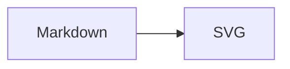

# satteri-pele

A [Sätteri](https://github.com/bruits/satteri) plugin for rendering Mermaid diagrams
by [Pele](https://github.com/obsidianmd/pele)

## Why Pele?

Pele is smaller and faster compared with Mermaid.js, and it can render the diagrams in server side (SSG/SSR), which
means **No Runtime**

## Installation

```bash
npm add @erduotong/satteri-pele
```

## Usage

Register both `peleMdast()` and `peleHast()` to turn fenced Mermaid code blocks into inline SVG.

### Sätteri Directly

Install Sätteri alongside the plugin:

```bash
npm add satteri
```

```typescript
import {markdownToHtml} from 'satteri';
import {peleHast, peleMdast} from '@erduotong/satteri-pele';

const source = ['```mermaid', 'flowchart LR', '  A --> B', '```'].join('\n');

const {html} = markdownToHtml(source, {
    mdastPlugins: [peleMdast()],
    hastPlugins: [peleHast()],
});

console.log(html); // <svg ...>...</svg>
```

### Astro

Use Astro's [Sätteri Markdown processor](https://docs.astro.build/en/guides/markdown-content/#markdown-processors):

```bash
npm add @astrojs/markdown-satteri satteri
```

```typescript
// astro.config.ts
import {satteri} from '@astrojs/markdown-satteri';
import {peleHast, peleMdast} from '@erduotong/satteri-pele';
import {defineConfig} from 'astro/config';

export default defineConfig({
    markdown: {
        processor: satteri({
            mdastPlugins: [peleMdast()],
            hastPlugins: [peleHast()],
        }),
    },
});
```

Then add a diagram to a Markdown page:

````markdown

````

The diagram is rendered on the server, with no client-side rendering script.

## Options

Both plugin functions accept a `SatteriPeleOptions` object:

| Option                   | Default          | Description                                                                                                                                                  |
|--------------------------|------------------|--------------------------------------------------------------------------------------------------------------------------------------------------------------|
| `languages`              | `['mermaid']`    | Code block languages handled by `peleMdast`. Replaces the default list; use `['mermaid', 'mmd']` to support both.                                            |
| `renderOptions`          | Pele defaults    | Options passed to Pele's `render()` by `peleHast`, such as `fontFamily`, `fontSize`, `responsive`, and `maxWidth`. See the [Pele API](https://pele.run/api). |
| `renderOptions.idPrefix` | `'satteri-pele'` | Base prefix for SVG IDs. The plugin appends a per-document diagram counter, such as `article-0` and `article-1`, to avoid collisions within a document.      |

Pass the same options to both plugins:

```typescript
import {peleHast, peleMdast} from '@erduotong/satteri-pele';
import type {SatteriPeleOptions} from '@erduotong/satteri-pele';

const options: SatteriPeleOptions = {
    languages: ['mermaid', 'mmd'],
    renderOptions: {
        fontFamily: 'sans-serif',
        fontSize: 16,
        idPrefix: 'article',
    },
};

const plugins = {
    mdastPlugins: [peleMdast(options)],
    hastPlugins: [peleHast(options)],
};
// Use plugins as the options for markdownToHtml(source, plugins)
// or for Astro's satteri(plugins).
```
